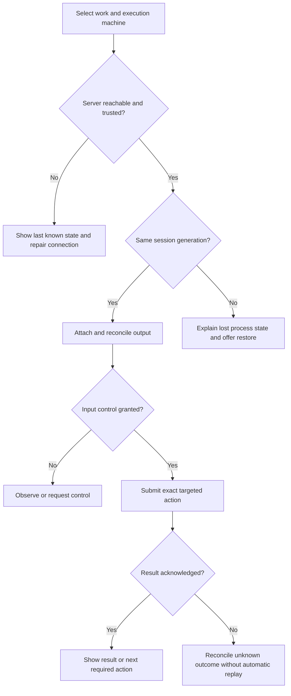

# Production user journeys and remote-session requirements

Status: working product contract, reviewed 2026-10-18. Current behavior is supported by source references; acceptance criteria describe the intended outcome and are not a statement that tests passed. Findings: [production readiness review](../production-readiness-review-2026-10-18.md).

## Product intent and scope

Let a person manage work across machines without remembering terminal windows, guessing where a command runs, or losing context when a client disappears. The workspace should answer: **what is running, where, what needs me, and what can I safely do next?** A terminal remains an available interaction surface; typed results, focused task views, and recovery controls make it more useful.

PsBash currently supplies Bash-like syntax, PowerShell objects, a local interactive shell, and agent command execution. It can be an execution component of a terminal product. This document does not assign session-server responsibilities to PsBash implicitly. The nearby BeagleTerm checkout appears to be such a product, but its relationship to this request remains unconfirmed. R journeys are proposed requirements wherever that product is owned.

### Actors

| Actor | Job to be done | Conditions that matter |
|---|---|---|
| New Windows developer | Run familiar commands and reach useful work quickly | No WSL required; machine may lack .NET/PowerShell; paths contain spaces/Unicode |
| PowerShell user | Keep typed results while using Bash command habits | Module scope and object identity matter; mixed pipelines must work |
| Agent/CI caller | Execute a bounded command and understand its result | Redirected stdin, exact streams, exit status, cancellation, independent invocations |
| Remote developer | Leave a build/agent running and return from another client | Intermittent SSH, client sleep, remote cwd, different OS and executable versions |
| Multi-project operator | Find blocked work and act on the right machine | Many similar sessions; one failing host must not block healthy hosts |
| Administrator | Install, update, diagnose and remove the product predictably | Artifact integrity, trust, retention, least privilege, recoverable changes |

### Scope labels

- **Current:** an implementation surface exists; its complete journey still needs acceptance evidence.
- **Partial:** implementation exists but a named limit or blocker affects this journey.
- **Proposed:** a session-product requirement absent from the reviewed PsBash surfaces.

### Acceptance definition

Every accepted journey needs an entry condition, observable successful outcome, negative path, recovery/abandonment behavior, execution location, persisted data policy, and repeatable evidence. Record the OS/client/server versions and whether the test used a source build, extracted release, or installed package. Unit tests do not establish a complete remote journey. A network failure must never be silently converted into command success.

## Journey inventory

| ID | User story | Scope | Main implementation/evidence | Release relevance |
|---|---|---|---|---|
| J01 | Install, verify, upgrade and remove | Partial | Installers, package scripts, release workflow | B02–B05 |
| J02 | Use familiar commands with typed objects | Current | Module, Cmdlets, transpiler | Existing product |
| J03 | Invoke the shell from an agent or CI | Partial | Shell Args/Program, IPC, compactor | Compatibility limits |
| J04 | Work in an interactive terminal | Current | InteractiveShell, LineEditor, PTY adapters | Platform acceptance |
| J05 | Safely change files and handle archives | Partial | Cmdlets/FileSystemHelpers, tar extraction | B01 |
| J06 | Find prior work without leaking private input | Partial | History store, Ctrl-R, suggestions | B08 |
| J07 | Navigate directories and recover missing context | Current | Frecency store, aliases, completion | Existing product |
| J08 | Review and use AI command assistance | Current, opt-in | CommandAssistProvider/Review, InteractiveShell | Egress and review |
| J09 | Inspect typed output and act on a selected item | Current | `browse`, styled output specs | Identity/action checks |
| J10 | Configure startup and extend completion/history | Partial | `.psbashrc`, plugin/config specs | Trust and recovery |
| J11 | Recover from command and host failures | Current | Host lifecycle, logs, watchdog, exit protocol | B05 |
| R01 | Create a workspace around a goal | Proposed | No reviewed workspace catalog | First managed-session slice |
| R02 | Add and trust a remote machine | Proposed | Current IPC is local | First remote slice |
| R03 | Detach and resume live work | Proposed | Current cleanup cancels/ends sessions | Core product promise |
| R04 | Notice and answer blocked agents | Proposed | No reviewed agent attention service | Core product promise |
| R05 | Switch clients and control input deliberately | Proposed | No reviewed writer/observer protocol | Advanced session promise |
| R06 | Diagnose network loss and recover uncertain commands | Proposed | No reviewed remote command ledger | Core remote reliability |
| R07 | Restore after server/host loss | Proposed | No reviewed workspace snapshot service | Recovery promise |
| R08 | Open/edit/transfer files and forward services on the right host | Proposed | Local cmdlets are not remote file/service APIs | Remote workflow scope |
| R09 | Update a running session server | Proposed | Current host replacement is invocation infrastructure | Lifecycle promise |
| R10 | Protect, inspect, export and delete session data | Proposed | Local history is only one data class | Managed-session privacy |
| R11 | Automate workspace work without a GUI | Proposed | `-c` exists; session orchestration does not | Headless promise |
| R12 | Stay usable for a working week and close deliberately | Proposed | Current host tests cover only selected shell lifecycle | Reliability signoff |

## Existing shell journeys

### J01 — Install and reach a useful first command

**Story:** as a new user, I can select the right package, verify it, and execute real work without diagnosing missing runtime files.

**Entry:** clean machine or previous installation; supported OS/architecture known. Module installation and standalone-shell installation are separate choices.

**Flow:** choose module/shell → resolve supported package → download/stage complete contents → verify version and real command → make entry point available → open a new terminal → run `echo ready; seq 1 3 | wc -l`.

**Acceptance:** extracted and installed packages both execute the pipeline with status 0; missing host/runtime gives an actionable failure; an unsupported RID is explained before download; existing config/history survive an upgrade; a failed upgrade leaves the previous working entry point available. Agent shell setup links to the dedicated guide rather than assuming every agent honors `SHELL`.

**Recovery/data:** retry downloads into staging, not over the active install. Uninstall explains executable/config/history locations and offers separate choices for keeping user data. Package-manager commands marked planned must not appear as working installation instructions. B02–B05 remain open; use the [manual installation path](../install.md).

### J02 — Keep object identity through familiar pipelines

**Story:** as a PowerShell user, I can filter familiar text and still inspect the original result's typed properties.

**Flow:** import module → `ls -la | grep '.ps1' | sort -k5 -h` → assign results → inspect `Name`/`SizeBytes` → pass selected objects into a PowerShell cmdlet.

**Acceptance:** empty/single/multiple outputs retain predictable object shapes; text presentation does not replace original objects; filenames with spaces/quotes/Unicode remain one item; a failed producer reports its error and status according to the documented compatibility contract. Tests cover module calls as well as transpiled calls, because PowerShell flag binding differs.

**Recovery/data:** syntax/flag errors explain the failing command. State whether redirected output is text or exact bytes. Link [intentional differences](../specs/intentional-differences.md); do not promise universal Bash identity or per-stage exit status.

### J03 — Run a command from an agent or CI

**Story:** as an automated caller, I can supply arguments/stdin and decide success from the command result.

**Flow:** configure the agent's actual shell selection mechanism → verify `$BASH_VERSION` → invoke `-c`, script, or supported stdin mode → capture stdout/stderr/status → handle timeout/cancellation.

**Acceptance:** quoting, positional arguments, cwd and environment match the documented mode; separate invocations do not leak prior functions/variables; timeout and host failure remain distinguishable; nonzero command status cannot turn into success during transport recovery. A missing command differs from no matches. Agent fallback to another shell is detectable during onboarding.

**Compact output:** opt in only for display/log consumption; never feed a digest into a data pipeline expecting exact output. Preserve status, stderr presence and useful diagnostics. Test flag/environment precedence and `--no-compact-output` override.

**Recovery/data:** a lost connection with an uncertain execution outcome must not cause a mutating command to run twice. For current Bash limits such as `pipefail`, select a compatible script or real Bash explicitly. Do not label a host daemon as an agent conversation/session store. Guides: [agent setup](../agent-setup.md), [compact output](../specs/compact-output.md).

### J04 — Use real terminal interaction

**Story:** as an interactive user, I can edit input and run existing full-screen tools with working keyboard and screen behavior.

**Flow:** launch shell → see prompt/readiness → type ahead → use completion → launch terminal tool → resize/cancel → return to a usable prompt.

**Acceptance:** Ctrl-C cancels the intended foreground work; EOF/exit, bracketed paste, Unicode/wide characters, wrapping and narrow terminals behave predictably; resize reaches the child; raw terminal mode is restored after normal exit and failure. Validate Windows ConPTY and supported Unix PTYs separately. Keyboard-only navigation covers completion, search and review dialogs. Screen-reader behavior requires an actual assistive-technology check, not a claim based on color contrast.

**Recovery/data:** preserve editable input after a dismissed panel; a missing TTY has an explicit supported fallback. Closing the current launcher is not documented as detach. Spec: [PTY contract](../specs/pty.md).

### J05 — Modify the intended files and extract archives

**Story:** as a developer, I can copy/move/remove/extract files without the program changing an unintended target.

**Entry:** cwd and destination are visible; tests use a disposable tree.

**Flow:** resolve operands → validate flags/targets → perform operation → report partial or complete result.

**Acceptance:** missing operands, denied access, read-only files, duplicate targets, path traversal, junctions/symlinks, spaces/Unicode and interrupted writes receive meaningful status and preserve unaffected files. Test filesystem state in addition to output. Protection against deleting roots is not a general rollback guarantee. An archive entry must not write outside its extraction boundary through a pre-existing or archive-created link. B01 currently fails that condition.

**Recovery/data:** distinguish safely retryable work from partial completion. Existing destructive shell commands do not gain undo merely by adding a richer UI. For a future action preview, bind the approved action to the exact target set and report changes between preview and execution.

### J06 — Recall work and choose what is retained

**Story:** as a user, I can find a useful command by project while keeping sensitive input out of persistent recall.

**Flow:** run command → record allowed metadata → search with Ctrl-R → inspect selected command → insert into editable input → execute only by deliberate submission.

**Acceptance:** selecting/previewing history does not run it; cancelled search restores the draft; cwd/session context is available; stale history cannot silently target the wrong machine. Proposed private mode suppresses capture before both database and in-memory suggestions; leading-space behavior is documented explicitly rather than assumed from Bash. Retention, inspect/export/delete and backup limits are visible. B08 remains open.

**Recovery/data:** read-only/full/corrupt history storage must not prevent command execution. Explain degraded recall and the preserved recovery location without printing command contents into diagnostics. History SQL schema and Ctrl-R UI specs alone do not satisfy this journey.

### J07 — Navigate by remembered project context

**Story:** as a developer, I can jump to a project and tell when a remembered location is stale.

**Flow:** enter `z`/`zi` or complete a directory → inspect selected path → switch cwd → observe prompt/context change.

**Acceptance:** ambiguous matches require selection; nonexistent/deleted paths give a recovery action; cancellation preserves cwd; permission failure does not claim success. Hooks finish or report failure without misleading completion. Frecency and suggestions are scoped to the machine that owns the path; do not reinterpret a remote path locally.

**Data:** frecency records reveal project names and locations. Include them in the retention/export policy. Spec: [directory jumping](../specs/frecency-jump.md).

### J08 — Request AI help and review the exact command

**Story:** as a user, I can opt into command suggestions, understand what leaves my machine, and decide what runs.

**Flow:** explicitly enable provider → invoke assistance on input → provider completes or times out → review/edit returned command → submit or cancel.

**Acceptance:** disabled/unconfigured/offline provider gives an actionable message while preserving input; no request is sent by default; disable wins over enable; cancellation ignores late results; malformed provider output does not run; review shows exact command and cwd, plus machine for future remote scope. No provider output, safety label, or confidence score bypasses execution authorization.

**Data/recovery:** current assistance sends the input line to an external model. Show this at enablement; avoid secrets in the line. Provider timeout restores local editing. Validate egress/command-review behavior separately. Spec: [command assistance](../specs/command-assist.md).

### J09 — Explore objects and act on the selected resource

**Story:** as a user, I can inspect a rich result and act on the resource represented by that row.

**Flow:** run typed pipeline → open `browse`/styled output → filter/sort/select → inspect details → invoke a permitted action → show outcome.

**Acceptance:** row selection uses stable identity rather than display index after sorting; stale resources cannot redirect an action; destructive actions expose their exact targets and permission requirements. Keyboard focus and plain-text/noninteractive output remain usable. Future remote rows include immutable execution location.

**Recovery/data:** cancellation has no side effect; partial action failures remain attached to their items. A rich renderer is not a sandbox for arbitrary plugins/actions. Spec: [object workbench](../specs/browse.md).

### J10 — Configure startup and extensions without losing a usable shell

**Story:** as a user, I can customize startup, diagnose a broken customization, and recover to a minimal shell.

**Flow:** inspect configuration source → change local config/profile → restart/reload supported settings → observe effective result; use `--noprofile`/`--norc` to bypass startup where supported.

**Acceptance:** syntax and loading errors identify the offending file; missing completion/history providers degrade explicitly; config writes preserve a recoverable previous version. Docs distinguish implemented extension loading from examples or future roadmap in the plugin spec. Startup scripts and loaded code have the user's execution privileges; never describe them as isolated without a sandbox.

**Data/recovery:** do not copy profile scripts, credentials or provider settings to a remote host implicitly. A safe-start path remains accessible even when normal startup fails. Specs: [configuration](../specs/config-format.md), [plugins](../specs/plugin-architecture.md).

### J11 — Diagnose a failed command or failed host

**Story:** as a user or agent, I can distinguish command failure, unsupported behavior, timeout, cancellation and host failure and take the right next action.

**Flow:** execute → receive progress/result or visible disconnection → inspect sanitized diagnostics → choose retry, repair or fresh invocation.

**Acceptance:** preserve stdout/stderr and exit semantics; malformed/deep input cannot silently kill every future command; a watchdog exit names its reason; slow readers are not mistaken for disconnected clients; a subsequent invocation can recover a failed host without blindly replaying the previous action. Host logs include useful identities and timing but do not dump environment or command secrets by default.

**Recovery/data:** explain that terminating a shared poisoned host can affect other commands there. Specs: [host lifecycle](../specs/host-lifecycle-contract.md), [errors](../specs/error-handling.md). Selected lifecycle tests passed in this review; complete journey acceptance remains open.

## Proposed managed-session journeys

### R01 — Start from the work, then choose a terminal

**Story:** as a developer, I create a workspace for a goal and see its repository, machine, sessions and next required action together.

**Entry/flow:** workspace overview → choose existing project or explicit new path → choose execution machine → validate repo/cwd/tools → launch shell or agent → see a work card and terminal.

**Acceptance:** local first use requires no remote credentials; the empty state offers one clear next step. Every session shows machine, cwd/repository and connection freshness. Similar workspace names on two hosts remain distinct. Failed/missing directory/tool keeps the user's configuration and offers repair rather than silently moving to another cwd.

**Recovery/data:** dismissing setup saves a draft without starting work. Distinguish a reusable workspace template from restoration of a previous live session. Suggested measure: time from verified install to first successful command; collect timing without command contents.

### R02 — Add a machine and establish trust

**Story:** as a remote developer, I connect an SSH host using existing credentials and understand exactly what gets installed and where work executes.

**Flow:** add label/SSH target → verify host identity → authenticate → read-only capability check → review required server/bootstrap action → connect → choose remote cwd.

**Acceptance:** support the chosen SSH config/key/agent/password/bastion scope explicitly; changed host keys stop for trust repair, never auto-accept. Cancellation closes prompts and leaves no accidental server replacement. Missing dependencies, unsupported OS/architecture and incompatible protocol produce a repairable state. No private key, password or forwarded-agent socket is stored in the machine catalog.

**Recovery/data:** transport failure preserves the profile and reports the failing stage. Bootstrap/update asks separately before terminating existing work. Record machine identity independent of its editable label; do not merge two machines solely because they share a hostname.

### R03 — Leave work running and resume it

**Story:** as a developer, I close a viewer, lose Wi-Fi or sleep my laptop while the server keeps the same live terminal processes.

**Flow:** start observable long-running work → detach/close client → verify from another client → reattach to same session identity → receive current state and bounded replay.

**Acceptance:** client lifetime does not own server PTY lifetime; idle shells retain cwd/functions/variables under the declared retention policy. Explicit stop and server loss are distinct from detach. Resume neither duplicates input nor reruns commands. Sequence/generation information detects replay gaps; output overflow is visible. Remote disk or buffer pressure cannot silently stall unrelated sessions.

**Recovery/data:** unsupported persistence is stated before launch. A recovered screen is labeled history; it is not proof the original process still exists. Measure successful reattachment and unexplained process loss, with no output collection required.

### R04 — Find the work that needs attention

**Story:** as an operator, I can see which agent needs input and answer it on the correct host without scanning every terminal.

**Flow:** work overview → filter needs-attention → inspect reason and freshness → open relevant session → answer → observe acknowledged state change.

**Acceptance:** distinguish working, needs input, completed, failed and unknown; show whether state came from an integration, terminal heuristic or stale last observation. Silence alone does not mean completed. Version-specific agent integrations degrade to unknown. Notifications survive a disconnected client without flooding on reconnect. Approval always refers to the exact current action and session generation.

**Recovery/data:** stale prompts are disabled until revalidated; terminal content cannot forge trusted approval controls. Cancelling an answer preserves the prompt. Parallel agents have independent cwd/environment/worktrees according to the selected policy. B07 must not turn one blocked job into an unresponsive workspace.

### R05 — Resume from another client and arbitrate input

**Story:** as a developer, I can view the same work from another device and explicitly take control when needed.

**Flow:** authenticate second client → discover authorized sessions → attach as observer → request/take writer control → send input → release control.

**Acceptance:** one declared writer policy prevents interleaved keystrokes; observers cannot send input or silently steal control. Lease expiry and reconnect do not replay stale buffered input. Terminal size has a defined owner; observer resize does not unexpectedly reflow the writer's terminal. Machine/server/session identities are stable across UI focus changes.

**Recovery/data:** a removed/revoked client loses subscriptions and mutation rights server-side. Define personal multi-client access separately from multi-user sharing; sharing is out of scope until authorization, audit and revocation journeys exist. Client-only layouts are distinguished from server-owned workspace state.

### R06 — Recover from network loss without guessing execution outcome

**Story:** as an operator, I can tell whether a command was submitted, acknowledged, completed or has an unknown outcome.

**Flow:** submit targeted action with request ID → receive acceptance → lose connection → reconnect to same server generation → reconcile request/result → inspect or explicitly resubmit if necessary.

**Acceptance:** failed acknowledgement does not trigger automatic replay of a mutation. Read-only discovery can retry with backoff/cancel. Deduplication has a documented scope and retention window; input streams cannot claim exactly-once behavior merely from request IDs. A new server generation invalidates unresolved assumptions.

**Recovery/data:** show last successful contact and uncertainty in the affected card while healthy hosts remain operable. Keep draft commands local and unsent until the user deliberately submits after recovery. Test loss before accept, after accept, during output, after completion and during input-control transfer.

### R07 — Recover after daemon restart, host reboot or lost storage

**Story:** as a user, I can restore useful context while understanding which processes and state were actually lost.

**Flow:** detect server loss → identify new generation → load verified snapshot → restore layout/context → resume eligible agent conversation with explicit support → mark other panes as new shells or repairable errors.

**Acceptance:** layout, recent screen, shell memory and native agent conversation are separate recovery layers. Arbitrary process memory is not claimed to survive reboot. Missing cwd/executable keeps a failed pane visible. Corrupt/newer snapshots are preserved before replacement; failed preservation cannot overwrite the original. Recovery never runs an untrusted stored command automatically.

**Recovery/data:** previous snapshots have bounded retention and restore instructions. Test corrupt/truncated state, unavailable mount, renamed repo, changed shell and invalid agent-session reference. See the truth table below.

### R08 — Work with remote files and services in their own context

**Story:** as a developer, I inspect/edit/transfer files and open a service without confusing local and remote resources.

**Flow:** select immutable host/session context → open resource → inspect full location/version → edit/transfer/forward → review outcome.

**Acceptance:** editor saves use the opened absolute identity and detect external modification; changed cwd cannot retarget the save. Unsupported/binary encodings do not silently corrupt content. Transfers show bytes, partial state and overwrite choice; reconnect does not repeat unknown writes. Port forwards bind safely, show owner/host/port, distinguish local from remote address, and close according to an explicit detach policy. Remote content is untrusted in previews and terminal control sequences.

**Recovery/data:** repair denied access, changed file and dropped transfer without losing a draft. If files/services are outside the first release, state that exclusion rather than presenting local operations as remote support.

### R09 — Update without surprising running work

**Story:** as an administrator, I can update a client or server and see which sessions are affected before deciding.

**Flow:** negotiate capabilities → stage verified update → show compatible/incompatible actions and live-session impact → approve any required stop → promote → reconnect/rollback.

**Acceptance:** compatible clients attach without replacing the server; incompatible features are disabled with an explanation. Stopping/replacing a server requires a distinct informed decision. An unanswered prompt is not approval or decline. Best-effort live handoff is labeled and has an explicit failure plan. Failed install does not overwrite the working binary set or snapshot.

**Recovery/data:** record tested commit/artifact digest/protocol and preserve diagnostics. The same rules apply to remote bootstrap, an administrative CLI and the GUI; background reconnect must not silently force replacement. B03–B05 illustrate why build success alone is insufficient release evidence.

### R10 — Control session data and diagnostic disclosure

**Story:** as a user, I can decide what is captured, inspect it, share a useful diagnostic bundle and remove retained data.

**Flow:** inspect data settings → opt into recording/egress where required → run work → preview/export selected diagnostics → delete selected data or remove profile.

**Acceptance:** enumerate command history, cwd/repository metadata, terminal replay, credentials, native-agent references, snapshots, logs and provider requests separately. Private mode takes effect before ingestion and suggestions. No transcript upload is implicit. Redaction is defense in depth, not a promise to detect every secret. Credentials use the platform's protected storage or SSH facilities, not profile JSON.

**Recovery/data:** explain deletion limits across backups, SQLite WAL, external agent/provider records and other attached clients. Forgetting a connection profile does not silently terminate running work; stopping work does not imply erasing history. Revocation is enforced server-side and audited without logging secret input. B08 is the local starting gap.

### R11 — Automate without an open GUI

**Story:** as an automated caller, I can list, inspect, create, wait for and stop authorized sessions using the same identity and result model as the UI.

**Flow:** authenticate → select machine/server/session explicitly → discover capabilities → request action → subscribe/wait with deadline → reconcile final result.

**Acceptance:** CLI/API JSON is versioned and distinguishable from terminal escape output; target selection does not depend on whichever tab a person focused. Cancellation releases subscriptions; event streams are bounded/resumable with gaps exposed. Read-only and mutation permissions differ. Expired requests do not emerge from an offline queue later without authorization. A command timeout, agent needs-input and transport loss have distinct outcomes.

**Recovery/data:** use R06's unknown-outcome rule. No `-c` compatibility claim implies a session orchestration API exists. Document supported headless operations and installation/version constraints.

### R12 — Operate for a working week and leave deliberately

**Story:** as a daily user, I can keep many sessions open without accumulating leaked processes, unbounded output or ambiguous close behavior.

**Flow:** connect/create → run/idle/detach/reattach repeatedly → observe bounded resources → close viewer, stop work, kill unresponsive work, archive workspace or forget profile deliberately.

**Acceptance:** a declared supported session/output load has CPU, memory, disk and latency budgets measured on reference machines. Saturated hosts expose backpressure/quotas; healthy hosts stay interactive. Many attach/detach/update cycles return resources to the expected baseline. A silent `/health` response alone is not evidence another shell can be created. Session ownership is queryable after client death.

**Recovery/data:** close/detach preserves work; stop asks the owning session to end; kill reports possible partial effects; archive affects retained workspace metadata; forget affects the local connection catalog. All actions name scope and affected work. If desktop exit stops a local server, disclose that behavior; do not call it detach.

## Recovery and state contract

These are proposed promises to validate, not current PsBash behavior.

| Event | Original processes | Shell memory/cwd | Layout/recent output | User-facing recovery |
|---|---|---|---|---|
| Viewer closes or network drops; session server healthy | Continue | Remain in live shell | Server state; bounded replay policy | Reattach same identity; never rerun work |
| Client sleeps; remote server healthy | Continue remotely | Remain remotely | Reconcile on wake | Show stale state until verified |
| Local host sleeps | Paused or OS-dependent | OS-dependent | Last known state | Report suspension; no promise of progress |
| Session server crashes/restarts | Not guaranteed | Not guaranteed | Verified snapshot/replay if enabled | Label reconstruction; resolve unknown requests |
| Execution host reboots | Original processes lost unless a separate OS facility proves otherwise | Lost for ordinary shells | Saved context only | Restore layout/new shells; supported native agent resume |
| Forced server update | Depends on explicitly supported handoff | Depends on handoff | Snapshot fallback | Show affected work before stop |
| Snapshot is corrupt/unreadable/newer | Independent of snapshot | Independent | Preserve original; no silent overwrite | Offer repair/import and readable error |

Keep machine reachability, session process state, client attachment, agent attention and output freshness as separate state dimensions. A disconnected machine is not evidence its agent stopped; historical output is not live progress. A stable identity includes machine, server generation and session ID. UI labels and local path strings are insufficient identifiers.

## Defensive acceptance matrix

| Risk | Required defense | Acceptance probe |
|---|---|---|
| Wrong-host action | Immutable target in request, server-side authorization, persistent location cue | Focus another tab during an in-flight action; target must remain unchanged |
| Duplicate mutation after reconnect | Durable outcome/reconciliation or explicit unknown state | Drop acknowledgement after acceptance; verify no automatic second execution |
| Observer injects input | Server-enforced writer/observer rights and lease | Send raw mutation from observer; server refuses independently of UI |
| Credential/terminal disclosure | Private capture policy, bounded retention, deliberate export/egress | Put a synthetic secret in private input; inspect DB, WAL, logs, replay and export |
| Output/agent impersonates trusted UI | Treat output as untrusted; authenticated integration events | Print approval-like text/escape sequences; no trusted action appears |
| Archive/file escapes destination | Real filesystem containment and conflict detection | Existing symlink/junction ancestor and replaced target; outside marker unchanged |
| One job denies service to the workspace | Execution isolation, bounded queues and fair cancellation | Flood/long job A while interacting with B; enforce declared latency budget |
| Update kills live work unexpectedly | Capability negotiation plus explicit stop decision | Unanswered replacement prompt leaves existing processes intact |
| Corrupt restore destroys recoverable state | Atomic versioned writes and preserve-before-overwrite | Crash during save and fail backup creation; original bytes remain |
| Revoked client keeps authority | Server-side revocation of requests and subscriptions | Revoke an attached client; subsequent input/export fails |

## Release slices and acceptance ledger

First accept J01–J11 for the advertised shell/platform scope. For a session product, implement R01–R03 plus R06/R10/R12 together as the smallest trustworthy local/SSH persistence slice; R04–R05 add agent attention and multi-client control. R07/R09 are mandatory before advertising restart/update recovery. R08/R11 can be deliberately deferred if their exclusions are visible. Cloud connectivity and multi-user collaboration need their own trust and account lifecycle work before inclusion.

For every journey, record `journey ID → scenario → automated/manual evidence → platform/source/artifact → result → unresolved limits → owner/date`. All journeys begin **unaccepted** until evidence is entered; the source inventory above is not signoff.

Minimum scenario matrix: local Windows; supported Unix local host; SSH Linux from Windows; Unicode/spaced cwd; empty/busy/failed workspace; client close/sleep; network failure; daemon restart; host reboot; denied auth/changed host key; concurrent clients; storage failure; unsupported version; high output; assistive input. Publish the chosen support matrix and name exclusions rather than treating unavailable test infrastructure as success.

Measure onboarding completion, reconnect success/time, unknown command outcomes, prompt/resize latency, unrecoverable process loss, resource growth and recovery success. Keep command/output content out of these metrics by default. Numeric performance budgets must be agreed and measured before claiming them.

## Competitive references

Herdr's documented live persistence, reconstruction layers, per-machine routing and agent attention informed R02–R09. The proposed product should make these contracts visible in a work-focused experience and add typed inspection without weakening ordinary terminal behavior. This is a design direction; no competitive superiority has been established by this review.

Vendor sources checked 2026-10-18: [overview](https://herdr.dev/), [persistence and restore](https://herdr.dev/docs/session-state/), [connecting machines](https://herdr.dev/docs/connecting-machines/), [agent status](https://herdr.dev/docs/agents/).
